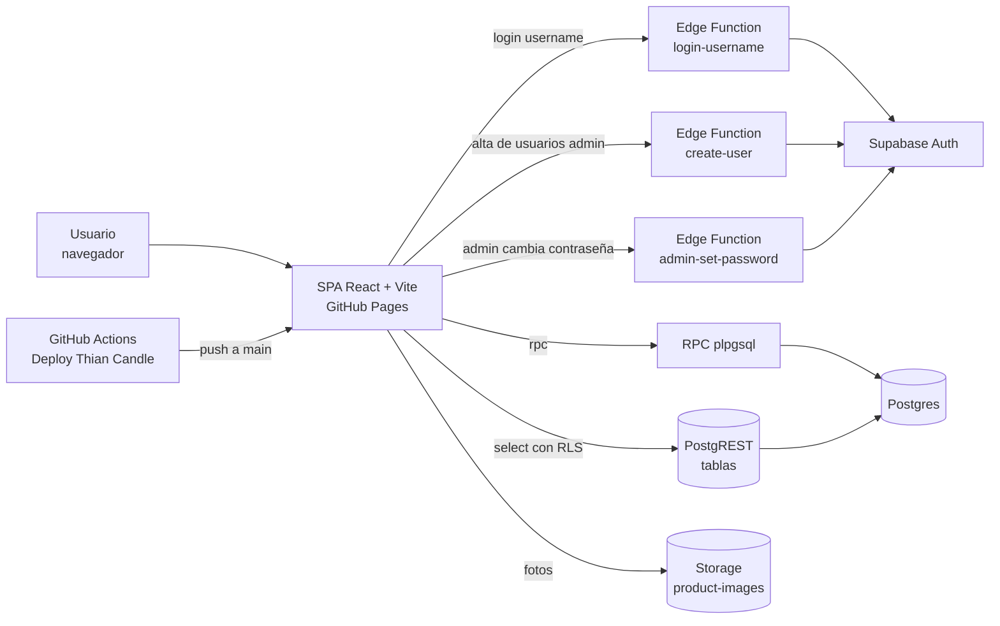

# Arquitectura — Thian Orders

SPA React servida desde GitHub Pages; toda la autorización vive en Supabase (RLS + RPC).
Ver [[trampas]] · [[plan-de-cambio]] · [[bitacora/2026-11-18-historico]].

## Datos (medido: `supabase/setup.sql`)
| Tabla | Para qué |
|---|---|
| `profiles` | Usuario: nombre, username, activo |
| `roles`, `user_roles` | Roles acumulativos por usuario |
| `products` | Catálogo: precio general, mayorista, categoría, proveedor (`supplier_id`), foto |
| `suppliers` | Proveedores de los productos; `own` = producción propia (lee: usuario activo; crea/modifica: admin) |
| `product_costs` | Historial de costos por producto (solo admin). La liquidación usa el vigente en la fecha de la factura |
| `wholesale_customers` | Categoría manual de cada cliente mayorista (distribuidor, tienda, revendedor, empresa, otro) y notas; clave = teléfono o nombre (`customerKey`). Solo admin (migración 20261127) |
| `price_lists` | Listas de precios mayoristas (nombre único, activa). Admin crea/modifica; el vendedor lee solo la suya (migración 20261127b) |
| `seller_price_lists` | Qué lista tiene cada vendedor (una por vendedor) = vendedor mayorista. Admin todo; el vendedor lee su fila. Fase 1: aún no cambia precios |
| `orders` | Pedido: cliente, entrega, mayorista, pago |
| `order_items` | Productos del pedido con estado de producción y precio congelado |
| `order_payments` | Historial de abonos y correcciones |

## RPC principales
| RPC | Quién | Qué hace |
|---|---|---|
| `create_order` | Vende (admin, seller) | Crea pedido; mayorista por referencia (12+ u. del mismo producto); domicilio; pago inicial |
| `update_order` | Admin, billing o vendedor dueño | Edita cliente, productos pendientes y pago |
| `set_order_item_status` | Producción | Cambia solo `order_items.status` |
| `order_seller_names` | Todos | Nombre del vendedor de pedidos visibles |
| `my_roles` | Todos | Roles del usuario actual |
| `register_payment` | — | Sin uso en la UI (los pagos se ajustan en Editar) |
| `void_invoice` | Admin | Anula una factura con motivo (no la borra); el pedido vuelve a Por facturar |
| `cancel_order` | Admin, billing; vendedor dueño si todo está pendiente | Marca el pedido como cancelado con motivo (no borra) |

## Frontend (medido: `src/main.jsx`)
- `App`: sesión, roles, carga de datos (`reload`), menú lateral y pestañas.
- Pestañas: Resumen (admin), Producción (production), Pedidos (+ botón Registrar pedido), Productos, Usuarios y roles (admin).
- Componentes: `OrderForm`, `ProductCatalog`, `OrderEditForm`, `Orders`, `PaymentHistory`, `Production`, `Modal`, `Lightbox`.

## En curso (no publicado)
Cancelar pedidos (`orders.cancelled_at`, `cancelled_by`, `cancel_reason`): `supabase/migrations/20261123_cancel_order.sql`.
Editar productos: solo frontend (RLS "products admin update" ya lo permite).
Facturación por entrega y domicilio por municipio: `supabase/migrations/20261121_billing.sql`
(tablas `delivery_zones`, `invoices`; RPC `create_invoice`). Ver [[bitacora/2026-11-23]].
