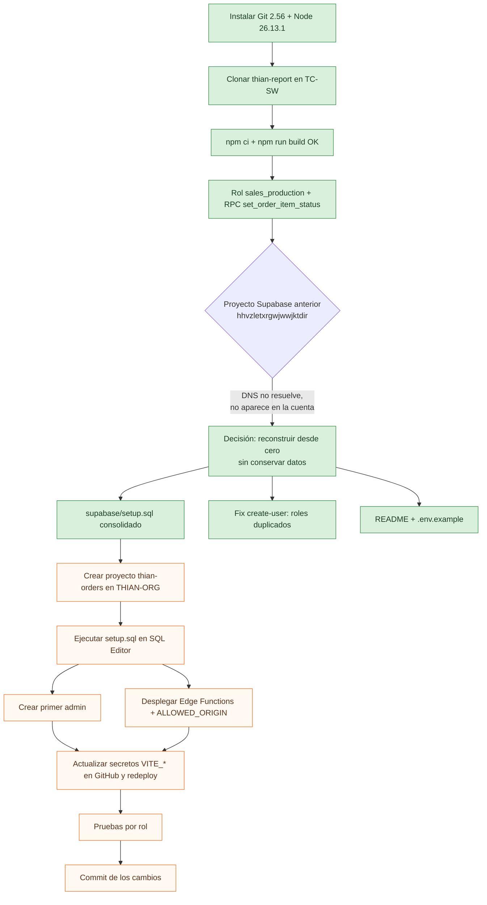
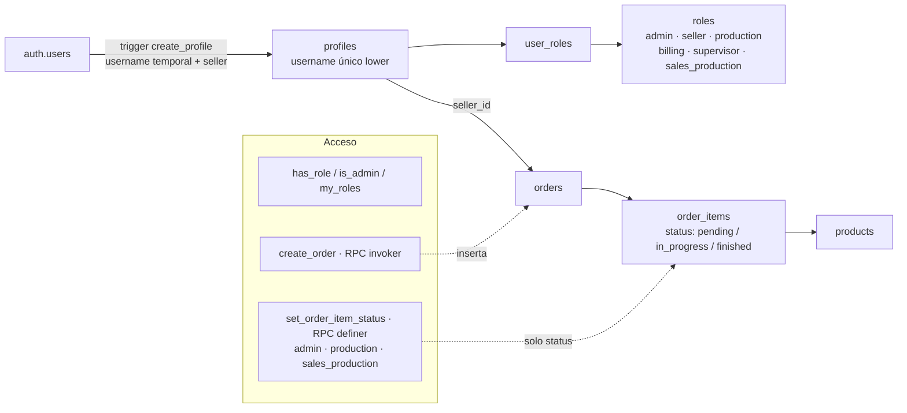
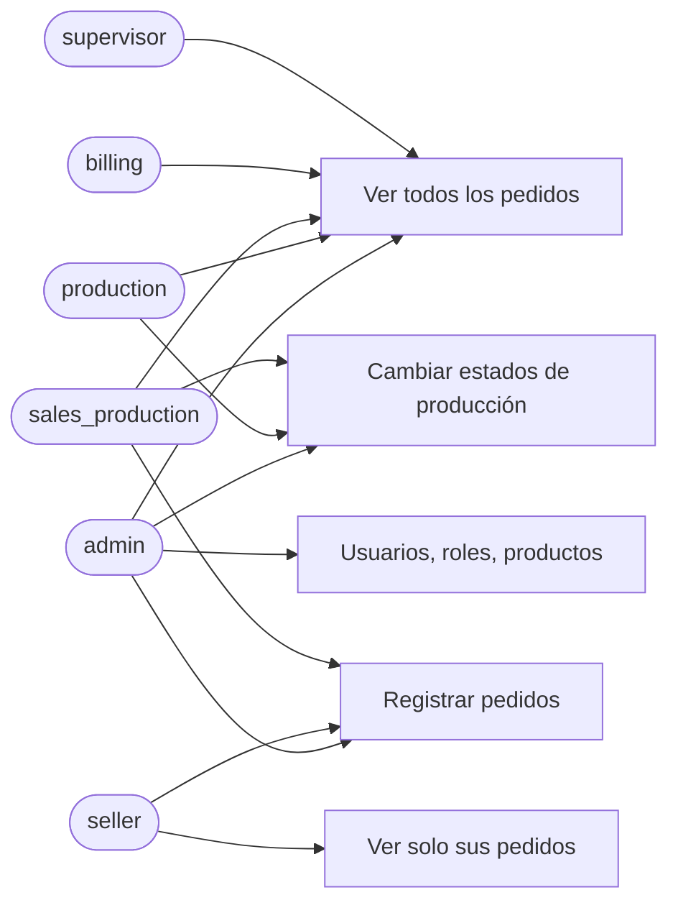

# Bitácora — Thian Orders

## Sesión 2026-11-18 — Entorno, roles/RLS y reconstrucción de Supabase

### Grafo 1 · Estado del trabajo

### Grafo 2 · Modelo de datos y autorización (setup.sql)

### Grafo 3 · Quién ve y hace qué

---

### Registro cronológico

| # | Acción | Resultado |
|---|---|---|
| 1 | Contexto del proyecto recibido; carpeta `TC-SW` vacía | Contexto guardado en memoria de Claude |
| 2 | Git y Node.js LTS instalados con winget | Git 2.56.0, Node 26.13.1, npm 11.20.0 |
| 3 | Clonado `thian-candle/thian-report` (rama `main`, v1.4.0) | Build OK |
| 4 | Revisión del código frente al documento de contexto | El código es más antiguo: sin Kanban, sin categorías/precios, sin `sales_production`; la columna es `order_items.status` |
| 5 | Usuario confirma que el repo es la versión actual | Las funciones del documento se tratan como pendientes |
| 6 | Rol `sales_production` + RPC de estados | `migrate_v1_2.sql`, `main.jsx` y `create-user` actualizados |
| 7 | Supabase: la cuenta no muestra organizaciones; el dominio del proyecto no resuelve | Decisión del usuario: empezar de cero, sin datos |
| 8 | Script único `supabase/setup.sql` | Incluye piezas que faltaban en el repo: `roles`, `user_roles`, `username`, `my_roles()` |
| 9 | Corrección en `create-user` | Antes fallaba al elegir `seller`, que el trigger ya asignaba |
| 10 | Scripts antiguos movidos a `supabase/legacy/` | Solo como referencia |
| 11 | Guía de creación del proyecto Supabase | Se añaden permisos a `service_role` en `setup.sql` porque "Grant API access" queda desactivado |

### Archivos tocados

| Archivo | Cambio |
|---|---|
| `src/main.jsx` | `canSell` y `canProduce` incluyen `sales_production`; estados mediante RPC; se elimina `canViewAll` (no se usaba) |
| `supabase/functions/create-user/index.ts` | Acepta `sales_production`; reemplaza el rol por defecto del trigger por los roles elegidos |
| `supabase/setup.sql` | Nuevo: esquema completo desde cero |
| `supabase/legacy/*` | `schema.sql`, `migrate_v1_1.sql`, `migrate_v1_2.sql`, `username_login_checks.sql` archivados |
| `README.md` | Reescrito: permisos por rol e instalación paso a paso |
| `.env.example` | Nuevo |
| `docs/bitacora.md` | Este archivo |

### Verificado
- `npm run build` compila sin errores tras cada cambio.

### No verificado
- `setup.sql` **no se ha ejecutado** en Postgres. La validación de sintaxis con un parser fue bloqueada.
- Las Edge Functions no se han desplegado ni probado.
- No hay pruebas con usuarios reales por rol.
- **Nada está commiteado.**

### Riesgos y pendientes
- Si `create-user` responde "Invalid JWT" en el proyecto nuevo, desplegarla con `--no-verify-jwt` (la función valida el token por sí misma).
- `production` y `sales_production` ven "—" como vendedor, porque `profiles` solo es legible por el propio usuario o por un admin. Se resolverá con el Kanban.
- `npm audit`: 2 vulnerabilidades (1 moderada, 1 alta) sin revisar.
- `login-username` no tiene límite de intentos.

### Migración del repositorio
- El repositorio pasa a `jars-23/thian-orders` (público) y se publica desde ahí:
  `https://jars-23.github.io/thian-orders/`.
- `vite.config.js`: `base` cambia a `/thian-orders/`. `ALLOWED_ORIGIN` pasa a `https://jars-23.github.io`.
- Remoto `origin` → `jars-23/thian-orders`; `upstream` → `thian-candle/thian-report`.

### Puesta en marcha (2026-11-18)
| Paso | Estado |
|---|---|
| Proyecto Supabase `thian-orders` (`cvqzfotbawqxcpepgqxn`) en THIAN-ORG | ✅ |
| `setup.sql` ejecutado: 6 tablas, 6 roles, 15 políticas, 0 tablas sin RLS | ✅ |
| Registro público desactivado | ✅ |
| Primer administrador creado (`admin` + `seller`) | ✅ |
| Secretos `VITE_SUPABASE_URL` / `VITE_SUPABASE_ANON_KEY` (clave publishable) en GitHub | ✅ |
| GitHub Pages activo: `https://jars-23.github.io/thian-orders/` | ✅ |
| `ALLOWED_ORIGIN=https://jars-23.github.io`, `login-username` y `create-user` desplegadas | ✅ |
| Inicio de sesión del administrador en la app publicada | ✅ (la contraseña guardada no coincidía; se fijó por SQL con `extensions.crypt` y se verificó) |
| `login-username` con logs de diagnóstico por paso (respuesta al cliente sigue siendo genérica) | ✅ redesplegada |
| Pruebas por rol (seller, production, sales_production, billing, supervisor) | ⏳ |
| Migración `20261118_order_seller_names.sql`: producción, facturación y supervisor ven el nombre del vendedor (solo `full_name`, sin abrir `profiles`) | ⏳ ejecutar en SQL Editor |

### Próximos pasos
1. Crear el proyecto `thian-orders` en la región East US, con RLS automático activado y "Grant API access" desactivado.
2. Ejecutar `setup.sql`, crear el primer administrador, desplegar las funciones y actualizar los secretos de GitHub.
3. Hacer pruebas por rol y luego commit.
4. Siguiente fase: separar `main.jsx` en módulos y construir el Kanban de producción.
